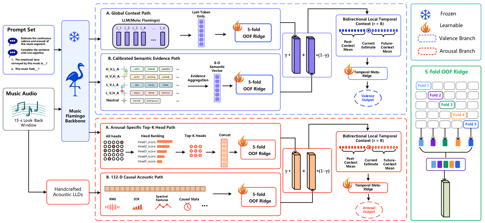

# HEVA

HEVA (Hierarchical Evidence organization for Valence-Arousal in DMER)
predicts continuous valence and arousal with dimension-specific
readouts over frozen Music Flamingo features. This repository contains the
preparation, training, evaluation, export, and inference code used in the
paper. Datasets, model weights, feature caches, and run outputs are not
included.

## Model Architecture



## Project Structure

```text
HEVA-main/
|-- README.md
|-- LICENSE                  # Apache License 2.0 for original repository code
|-- framework.png            # HEVA model architecture figure
|-- requirements.txt          # Pinned Python dependencies
|-- prepare.py                # Build manifests and feature caches
|-- run.py                    # Training and evaluation entry point
|-- infer.py                  # Inference entry point for one audio file
|-- splits/                   # Song-level splits used in the paper
|   |-- deam/
|   |   |-- train.txt
|   |   `-- test.txt
|   `-- pmemo/
|       |-- train.txt
|       `-- test.txt
|-- configs/
|   |-- main.yaml             # Dataset paths and fixed main hyperparameters
|   `-- frozen.yaml           # Frozen heads and Ridge settings for each seed
`-- heva/
    |-- __init__.py
    |-- audio.py              # Audio decoding and frozen feature extraction
    |-- config.py             # YAML loading and configuration validation
    |-- datasets.py           # DEAM and PMEmo cache loading and alignment
    |-- features.py           # Feature shard loading and row matching
    |-- inference.py          # Model package serialization and inference
    |-- metrics.py            # PCC, CCC, and RMSE
    |-- runner.py             # End-to-end training and evaluation workflow
    |-- splits.py             # Grouped holdout and five-fold OOF splitting
    `-- models/
        |-- __init__.py
        |-- valence.py        # Valence evidence paths and final readout
        |-- arousal.py        # Arousal evidence paths and expert heads
        |-- temporal.py       # Bidirectional local temporal context
        `-- ridge.py          # CPU and CUDA Ridge implementations
```

## Environment

Use Python 3.12 with an NVIDIA driver compatible with CUDA 12.8. Install the
dependencies from the repository root:

```bash
python -m pip install -r requirements.txt
```

## Required Inputs

Prepare the DEAM and PMEmo datasets and a local, Transformers-compatible Music
Flamingo checkpoint before extracting features.

The raw datasets must follow this layout:

```text
/path/to/DEAM/
|-- MEMD_audio/
`-- annotations/annotations averaged per song/
    `-- dynamic (per second annotations)/
        |-- valence.csv
        `-- arousal.csv

/path/to/PMEmo/
|-- mp3/
`-- meta/
    `-- dynamic_annotations.csv
```

The song-level protocol is stored in `splits/deam/` and `splits/pmemo/`. Each
`train.txt` and `test.txt` file contains one song ID per line. `prepare.py`
uses these lists by default and never creates a random train/test split. Pass
`--split-root /path/to/custom/splits` only when evaluating another protocol.

Define the input and output paths:

```bash
export DEAM_ROOT=/path/to/DEAM
export PMEMO_ROOT=/path/to/PMEmo
export MUSIC_FLAMINGO_ROOT=/path/to/nvidiamusic-flamingo-2601-hf
export HEVA_DATA_ROOT=/path/to/heva-features
```

## Feature Preparation

Generate all DEAM caches:

```bash
CUDA_VISIBLE_DEVICES=0 python prepare.py \
  --dataset deam \
  --stage all \
  --dataset-root "$DEAM_ROOT" \
  --output-root "$HEVA_DATA_ROOT" \
  --backbone "$MUSIC_FLAMINGO_ROOT" \
  --device cuda:0 \
  --acoustic-device cuda:0 \
  --shard-size 128 \
  --resume
```

Generate all PMEmo caches:

```bash
CUDA_VISIBLE_DEVICES=0 python prepare.py \
  --dataset pmemo \
  --stage all \
  --dataset-root "$PMEMO_ROOT" \
  --output-root "$HEVA_DATA_ROOT" \
  --backbone "$MUSIC_FLAMINGO_ROOT" \
  --device cuda:0 \
  --acoustic-device cuda:0 \
  --shard-size 128 \
  --resume
```

The `all` stage creates the manifest, Music Flamingo global features,
attention-head features, semantic evidence, 132-dimensional acoustic
features, and an integrity report. Music Flamingo remains frozen throughout
feature extraction.

Feature extraction is resumable: `--resume` skips complete shards. Individual
stages are available through `--stage manifest`, `backbone`, `semantic`,
`acoustic`, or `verify`.

## Reproduce the Main Results

Check the resolved configuration without loading feature caches:

```bash
python run.py --dataset deam --seed 42 --branch both --backend cuda --dry-run
python run.py --dataset pmemo --seed 42 --branch both --backend cuda --dry-run
```

Run all five fixed seeds for DEAM:

```bash
CUDA_VISIBLE_DEVICES=0 python run.py \
  --dataset deam \
  --all-seeds \
  --branch both \
  --backend cuda
```

Run all five fixed seeds for PMEmo:

```bash
CUDA_VISIBLE_DEVICES=0 python run.py \
  --dataset pmemo \
  --all-seeds \
  --branch both \
  --backend cuda
```

## Export and Run Inference

Train one complete model and export its inference package:

```bash
mkdir -p models

CUDA_VISIBLE_DEVICES=0 python run.py \
  --dataset deam \
  --seed 42 \
  --branch both \
  --backend cuda \
  --model-output models/deam_seed42.npz
```

Run dynamic Valence/Arousal prediction for one MP3 file:

```bash
CUDA_VISIBLE_DEVICES=0 python infer.py \
  --audio /path/to/song.mp3 \
  --model models/deam_seed42.npz \
  --backbone "$MUSIC_FLAMINGO_ROOT" \
  --base-device cuda:0 \
  --semantic-device cuda:0 \
  --output outputs/song_va.csv
```

The input audio must be at least 15 seconds long. The output CSV contains the
columns `time`, `valence`, and `arousal`.

## License and Third-Party Terms

Copyright 2026 HEVA Authors.

The original HEVA source code and documentation in this repository are
licensed under the [Apache License 2.0](LICENSE).

The Apache License 2.0 applies only to the original content distributed in
this repository. It does not relicense any external model, dataset, audio
recording, generated cache, or third-party Python package.

- **Music Flamingo:** Model weights are not included in this repository. They
  must be obtained from the
  [official NVIDIA model page](https://huggingface.co/nvidia/music-flamingo-2601-hf)
  and are governed by the NVIDIA OneWay Noncommercial License and any
  additional terms stated in the official model card.
- **DEAM:** Audio and annotations are not included. Obtain them from the
  [official DEAM resource](https://cvml.unige.ch/databases/DEAM/) and follow
  the dataset terms and citation requirements.
- **PMEmo:** Audio and annotations are not included. Obtain them from the
  [official PMEmo resource](https://www.next.zju.edu.cn/cn/archive/pmemo/) and
  follow the dataset terms and citation requirements.
- **Python dependencies:** Packages installed through `requirements.txt`
  remain subject to their respective licenses and terms.

Users are responsible for confirming that their intended use complies with
all applicable third-party licenses, dataset terms, and model restrictions.
